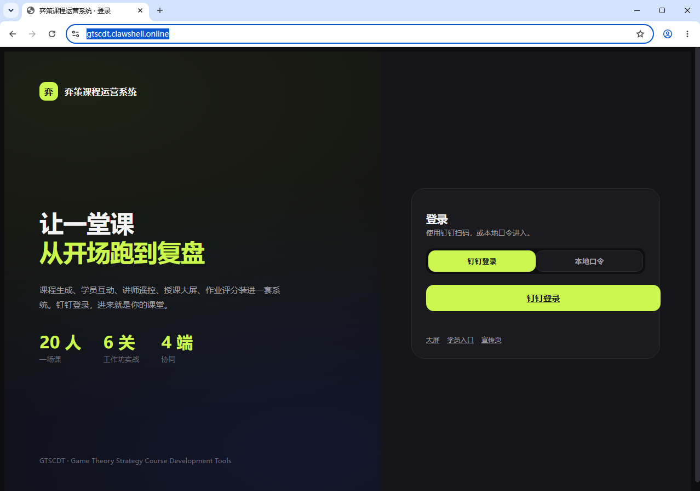
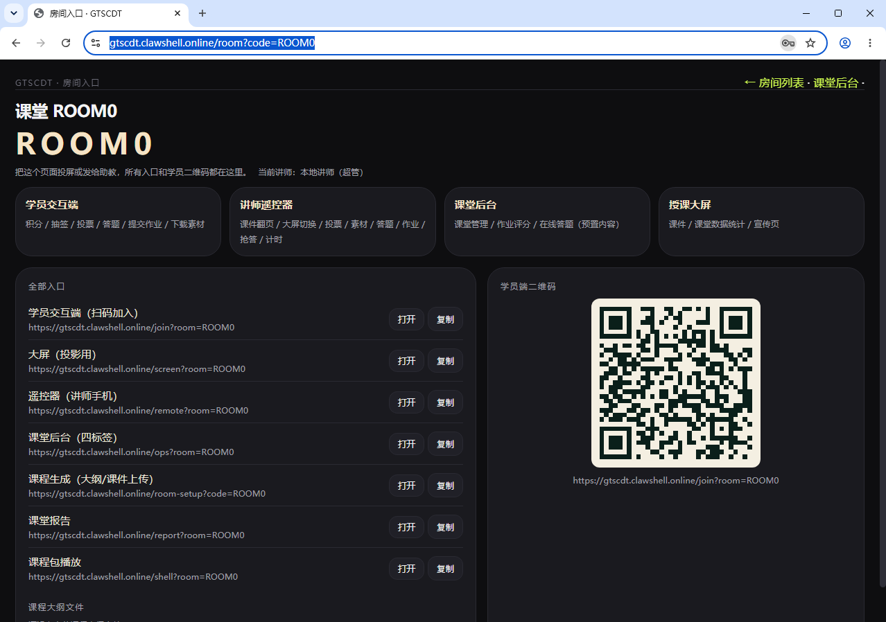
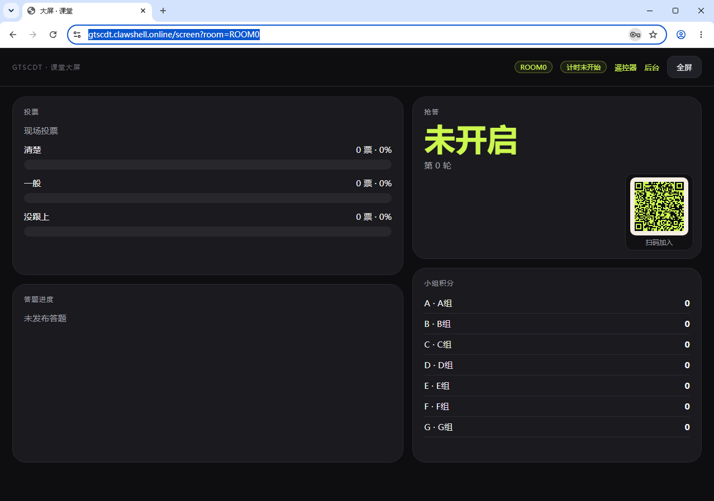
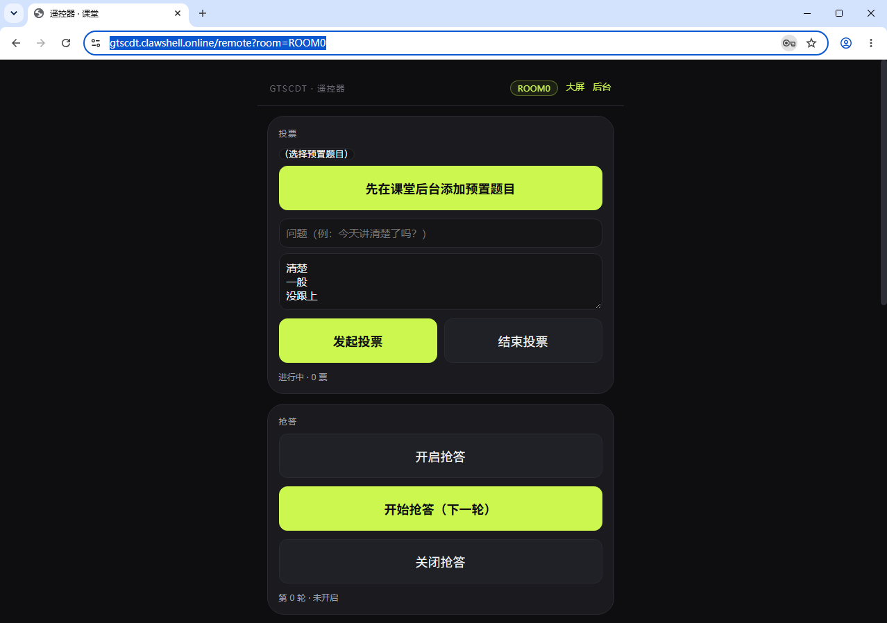
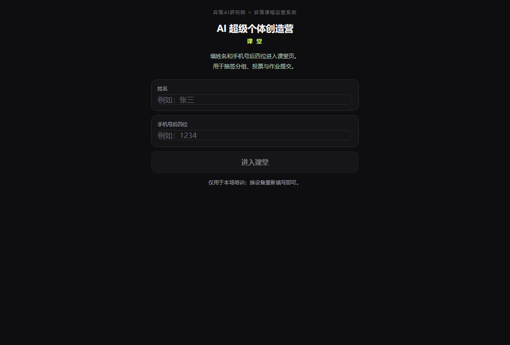
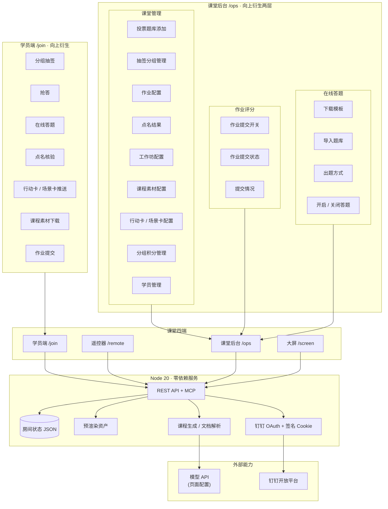

# Yice Strategy Course Operation Tool（弈策课程运营系统）

简称 **YSCOT**。

<div align="center">

**把一堂企业 AI 培训，从课前生成跑到课后复盘。**

[](https://github.com/jorinyang/YSCOT/releases)
[](https://nodejs.org/)
[](LICENSE)
[](https://open.dingtalk.com/)
[](#contributing)


</div>

讲师把课程大纲和课件丢进来，系统用模型生成课程页、宣传页、题库、过程素材和作业场景题；课堂上学员端、遥控器、课堂后台、大屏四个端同时跑；下课前作业评分和课堂报告已经就绪。

> **YSCOT（Yice Strategy Course Operation Tool）** · 企业 AI 培训的课堂运营系统
> 原名 GTSCDT（Game Theory Strategy Course Development Tools），2026-10 更名为 YSCOT。
> Node 20 零依赖服务 · 钉钉登录 · 房间模型 · 可私有化部署

---

## 为什么做这个

企业培训的痛点从来不是"没有课件"，而是**课件之后的整条链路**：

- 课前：大纲要变成课程页、宣传页、题库、素材、作业题，每次重做；
- 课中：投票、抢答、计时、分组、作业提交散落在不同工具里；
- 课后：作业评分靠人工翻文件，课堂数据留不下来。

YSCOT 把这三段接成一条流水线：**一次上传，生成一套内容；一个房间，跑完一堂课；一份报告，留下全部过程数据。**


---

## 页面预览

> 截图来自本地 `ROOM0` 演示房间。

| 登录 | 课程房间 |
| :---: | :---: |
|  |  |
| **授课大屏** | **讲师遥控器** |
|  |  |
| **学员端** | |
|  | |

---

## 功能

### 1 · AI 课程生成

上传课程大纲与课件，一次生成整套课堂内容：

| 生成物 | 用途 |
| --- | --- |
| 课程页 | 学员可回看的课程内容 |
| 宣传页 | 课程预热与招生 |
| 题库 | 选择 / 判断 / 填空 / 简答 |
| 过程素材 | 案例、模板、参考材料 |
| 作业场景题 | 工作坊六关实战任务 |

- 支持 **docx / pptx / pdf / md / txt / html** 解析；
- **pptx / pdf / html 保留原文件**用于展示下载；
- **md / txt 生成统一风格的大纲框架页**；
- 生成使用「模型配置」里保存的模型，不绑定厂商。

### 2 · 课堂四端

| 端 | 入口 | 学员 / 讲师能做什么 |
| --- | --- | --- |
| 学员交互端 | `/join` | 积分、抽签、投票、答题、提交作业、下载素材 |
| 讲师遥控器 | `/remote` | 预置题目投票、素材发放、作业开关、开始答题、抢答轮次、工作坊计时、大屏切换、课件翻页 |
| 课堂后台 | `/ops` | 投票题库、素材上传、分组、抢答开关、表现分、作业评分、在线答题 |
| 授课大屏 | `/screen` | 数据统计 / 课程页 / 宣传页三视图，学员扫码加入 |


### 3 · 房间与权限

- 房间默认名 = **日期 + 城市**，可编辑、可删除；
- 每个房间独立状态：学员、分组、投票、答题、作业、报告、素材；
- **超级管理员看全部房间，讲师只看自己的房间**；
- 钉钉登录保存头像、姓名、角色、部门；新讲师首次登录自动入名单；
- 工作台四个标签：房间管理（默认）/ 模型配置 / 个人信息 / 讲师管理（超管）。

### 4 · 内容与集成

- **课程包**：上传 HTML、AI 生成、在线编辑五类内容；
- **预渲染资产**：作业任务生成静态 HTML，学员页按版本缓存加载；
- **嵌入**：`/embed.js` + `/embed` 小组件；
- **MCP**：`/mcp` JSON-RPC，把课堂能力暴露给 Agent；
- **报告**：学员、小组、答题、作业汇总，CSV 导出；
- **全局响应式**：课堂后台、讲师遥控器、学员移动端共用一套断点与触控规则，手机 / 平板 / 桌面自适应。

---

## 架构



**设计取向**

- **内容可导入**：投票题库、课程素材、行动卡 / 场景卡、作业评分标准都提供 MCP 工具，按场次写入；
- **随机卷**：在线答题的 `random` 模式为每个学员单独抽题，防止互相抄答案。

- **房间是核心对象**：内容、人、交互、报告都挂在房间上；
- **单文件 JSON 状态**：零数据库依赖，可直接拷贝、归档、迁移；
- **四端共用一个状态源**：轮询/提交都走同一份房间状态，避免多端不一致；
- **模型可替换**：Base URL、模型名、Key 都在页面配置，不写死厂商。

---

## 快速开始

```bash
git clone https://github.com/jorinyang/YSCOT.git
cd YSCOT/templates
node server.mjs
```

打开 <http://127.0.0.1:8899>；线上：<https://yscot.clawshell.online>：

| 页面 | 地址 |
| --- | --- |
| 登录 / 工作台 | `/` → `/home` |
| 课程房间 | `/room?code=ROOM0` |
| 课程内容 | `/room-setup?code=ROOM0` |
| 课堂后台 | `/ops?room=ROOM0` |
| 遥控器 | `/remote?room=ROOM0` |
| 大屏 | `/screen?room=ROOM0` |
| 学员端 | `/join?room=ROOM0` |

Docker：

```bash
docker build -t yscot .
docker run -d -p 8899:8899 \
  -e SESSION_SECRET=change-me \
  -e LOCAL_TEACHER_PASSWORD=change-me \
  yscot
```

### 环境变量

| 变量 | 作用 |
| --- | --- |
| `PORT` | 端口，默认 `8899` |
| `SESSION_SECRET` | 登录 Cookie HMAC 密钥 |
| `LOCAL_TEACHER_PASSWORD` | 本地口令兜底 |
| `DINGTALK_CLIENT_ID` / `DINGTALK_CLIENT_SECRET` / `DINGTALK_CORP_ID` | 钉钉登录与部门同步 |
| `PUBLIC_URL` | 公网地址，用于钉钉回调 |
| `REQUIRE_AUTH` | `1` 开启强制登录 |
| `MCP_TOKEN` | MCP 访问令牌 |
| `DEEPSEEK_API_KEY` / `DEEPSEEK_BASE` / `DEEPSEEK_MODEL` | 模型兜底配置（页面配置优先） |

---

## 一堂课的完整流程

1. **建房**：登录 → 房间管理 → 填城市/日期（名称留空即日期+城市）；
2. **上传**：课程大纲 + 课件；pptx/pdf/html 保留原文件，md 生成框架页；
3. **生成**：进度条走完，课程页/宣传页/题库/素材/作业题一起产出；
4. **上课**：学员扫码加入 → 抽签分组 → 投票/抢答/答题 → 工作坊计时 → 作业提交；
5. **评分**：课堂后台作业评分，AI 评分可复核；
6. **复盘**：报告导出，积分公布；房间保留或删除。

完整操作说明见 [docs/06-课堂使用说明-按课程流程.md](docs/06-课堂使用说明-按课程流程.md)。

通过 MCP 导入投票题库、课程素材、行动卡 / 场景卡、作业评分标准的字段与示例，见 [docs/09-MCP内容导入标准.md](docs/09-MCP内容导入标准.md)。

---

## 目录结构

```
YSCOT/
├─ templates/
│  ├─ server.mjs              房间 / 鉴权 / 生成 / 上传 / API / MCP
│  ├─ ui.css                  全站主题（近黑 + 荧光绿 + 大圆角）
│  ├─ login.html              分屏登录
│  ├─ home.html               工作台
│  ├─ room.html               课程房间（四端入口 + 二维码）
│  ├─ room-setup.html         课程上传 / 生成 / 进度
│  ├─ course/admin.html       课堂后台
│  ├─ remote.html             讲师遥控器
│  ├─ screen.html             授课大屏
│  ├─ live.html               学员端
│  ├─ report.html             课堂报告
│  ├─ packages.html           课程包管理
│  ├─ package-edit.html       课程包编辑
│  ├─ course-render.mjs       课程包渲染
│  └─ materials/              学员素材
├─ docs/
│  ├─ images/                 README 图片
│  └─ *.md                    方法论 / 使用说明 / 部署
├─ deploy/                    Nginx / Compose / 环境变量模板
├─ Dockerfile
└─ scripts/
```

---

## Roadmap

- [x] 房间模型与四端协同
- [x] 钉钉登录、头像/角色、讲师与房间权限
- [x] AI 课程生成（课程页 / 宣传页 / 题库 / 素材 / 作业）
- [x] 大纲原文件保留、Markdown 框架页
- [x] 遥控器 ↔ 大屏 ↔ 后台联动
- [x] 全站视觉统一（参考 wb 风格）
- [ ] 作业配置可视化
- [ ] 课程包多模板
- [ ] 移动端细节优化
- [ ] 英文界面

---

## 版本记录

| 版本 | 内容 |
| --- | --- |
| **v0.4.1** | CUA 视觉复核修复：遥控器限宽、大屏二维码与强调色、学员端输入框、禁用态；测试房间清理 |
| **v0.4** | 参考 wb 风格全站改版、分屏登录、工作台四标签、房间归属、大纲原文件与 md 框架页、四端联动 |
| **v0.3** | 房间模型、大屏/遥控器、讲师登录、课程包、嵌入与 MCP |
| **v0.2** | 后台四标签、在线答题、模型管理、AI 评分 |
| **v0.1** | 六页面 + 局域网服务 |

更详细的变更见 [Releases](https://github.com/jorinyang/YSCOT/releases)。

---

## 文档

- [系统总体说明](docs/01-系统说明-YSCOT.md)
- [方法论与设计原则](docs/02-方法论与设计原则.md)
- [课程包架构](docs/05-架构-房间与课程包.md)
- [课堂使用说明](docs/06-课堂使用说明-按课程流程.md)
- [钉钉联调与上线清单](docs/07-钉钉联调与上线清单.md)
- [公网部署说明](docs/08-公网部署说明.md)

---

## Contributing

欢迎 Issue / PR。提交前请确认：

1. `node server.mjs` 可以本地跑通；
2. 改动的页面在桌面与手机宽度都能正常显示；
3. 不提交真实客户名、讲师信息、密钥与生产数据。

## License

[MIT](LICENSE) © jorinyang
